<small>**C**égep du **V**ieux **M**ontréal&nbsp;&nbsp;&nbsp;|&nbsp;&nbsp;&nbsp;**S**ciences, **I**nformatique et **M**athématique</small><br><br>

# Catalogue des widgets fournis

Les widgets suivants sont offerts par la bibliothèque `edustem`. Chacun se trouve dans son propre fichier `q_*.py` du dossier `edustem/pyside6/widgets/`. Chacun a aussi une démonstration dans `edustem/pyside6/widgets/demo/`, à lancer depuis le dossier `sf3` :

```
python -m edustem.pyside6.widgets.demo.demo_q_real_slider
```

---

## `QColorBox`

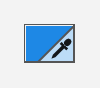

Carré de couleur. Un clic ouvre le sélecteur de couleur. Le coin replié, en bas à droite, lance la pipette : elle prend une couleur n'importe où à l'écran.

| Élément | Détail |
| :--- | :--- |
| Importation | `from edustem.pyside6.widgets.q_color_box import QColorBox` |
| Couleur | `color()`, `setColor(QColor)` |
| Signal | `colorChanged(QColor)` |
| Pipette | `pickScreenColor()`, ou la touche I ; sa commande : `setEyedropperButton(QColorBox.EyedropperButton.Section)` (`Corner` par défaut, `Section`, `Hidden`) |

```python
box = QColorBox(QColor("#1e88e5"))
box.colorChanged.connect(self.setCurveColor)
```

---

## `QColorEdit`

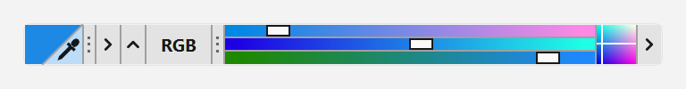

Éditeur de couleur sur une rangée, de la hauteur d'un `QLineEdit`. Après la couleur, une bande par canal (RGB, HSV, HSL ou CMYK) : chaque bande montre les couleurs qu'on obtiendrait en y glissant la poignée. Au bout, un plan à deux canaux, qui s'ouvre en grand d'un clic. La poignée à points, à gauche des bandes, ouvre une zone où taper les valeurs.

| Élément | Détail |
| :--- | :--- |
| Importation | `from edustem.pyside6.widgets.q_color_edit import QColorEdit` |
| Couleur | `color()`, `setColor(QColor)` |
| Signal | `colorChanged(QColor)` |
| Espace | `setColorSpace(QColorEdit.ColorSpace.Hsv)` : `Rgb` (défaut), `Hsv`, `Hsl`, `Cmyk` |
| Notation | `setValueNotation(QColorEdit.ValueNotation.Real)` : `Integer` (0 à 255, défaut), `Real` (0 à 1), `Hexadecimal` |
| Alpha | `setAlphaVisible(True)` : une bande de plus |
| Texte | `setTextVisible(True)`, ou la touche F2 ; Ctrl+C et Ctrl+V copient et collent la couleur |
| Pipette | `pickScreenColor()`, ou la touche I, comme `QColorBox` |

```python
edit = QColorEdit(QColor("tomato"))
edit.setColorSpace(QColorEdit.ColorSpace.Hsv)
edit.colorChanged.connect(self.setCurveColor)
```

---

## `QScreenColorPicker`

La pipette de `QColorBox` et de `QColorEdit`, utilisable seule, par exemple derrière un bouton. Au lancement, l'écran se fige. Un réticule et une loupe suivent la souris, et un clic prend la couleur du pixel visé. Échap abandonne.

| Élément | Détail |
| :--- | :--- |
| Importation | `from edustem.pyside6.widgets.q_screen_color_picker import QScreenColorPicker` |
| Lancer | `start()` |
| Signaux | `colorSelected(QColor)`, `canceled()` |
| Réglages | `setZoom(int)` (la loupe), `setSampleSize(int)` (1 à 9 : la zone moyennée), `setReferenceColor(QColor)` (la couleur comparée) |

```python
picker = QScreenColorPicker(self)
picker.colorSelected.connect(self.setCurveColor)
button.clicked.connect(picker.start)
```

---

## `QLatexLabel`

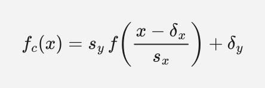

Affiche une formule LaTeX, rendue par MathJax.

| Élément | Détail |
| :--- | :--- |
| Importation | `from edustem.pyside6.widgets.q_latex_label import QLatexLabel` |
| Formule | `latex()`, `setLatex(str)` |
| Rendu | Asynchrone : la formule apparaît après un court délai. |

```python
label = QLatexLabel(r"f(x) = \sin x")
label.setLatex(r"f'(x) = \cos x")
```

---

## `QPythonCodeView`

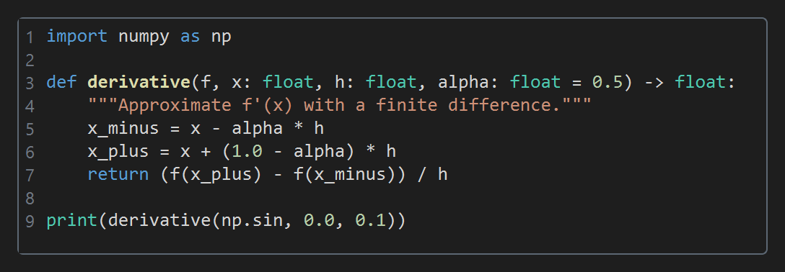

Affiche du code Python coloré, avec les numéros de ligne.

| Élément | Détail |
| :--- | :--- |
| Importation | `from edustem.pyside6.widgets.q_python_code_view import QPythonCodeView` |
| Texte | `setPlainText(str)`, hérité de `QPlainTextEdit` |
| Option | `QPythonCodeView(showLineNumbers=False)` masque les numéros. |

```python
view = QPythonCodeView()
view.setPlainText("print('Bonjour')")
```

---

## `QRealSlider`

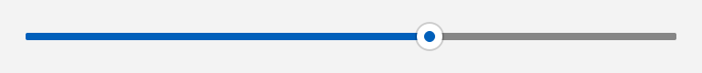

Curseur qui porte une valeur réelle plutôt qu'entière.

| Élément | Détail |
| :--- | :--- |
| Importation | `from edustem.pyside6.widgets.q_real_slider import QRealSlider` |
| Valeur | `value()`, `setValue(float)`, `setRange(lo, hi)`, `setDecimals(n)` |
| Signal | `valueChanged(float)` |

```python
slider = QRealSlider(Qt.Orientation.Horizontal)
slider.setRange(-5.0, 5.0)
slider.valueChanged.connect(self.updatePlot)
```

---

## `QRealScrollBar`

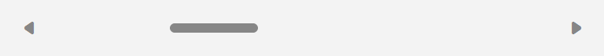

Barre de défilement qui porte une valeur réelle. L'image la montre survolée : au repos, le style Windows 11 la réduit à un mince trait.

| Élément | Détail |
| :--- | :--- |
| Importation | `from edustem.pyside6.widgets.q_real_slider import QRealScrollBar` |
| Valeur | `value()`, `setValue(float)`, `setRange(lo, hi)`, `setPageStep(float)` |
| Signal | `valueChanged(float)` |

```python
bar = QRealScrollBar(Qt.Orientation.Horizontal)
bar.setRange(0.0, 100.0)
bar.valueChanged.connect(self.scrollTo)
```

---

## `QRealDial`


Bouton rotatif qui porte une valeur réelle.

| Élément | Détail |
| :--- | :--- |
| Importation | `from edustem.pyside6.widgets.q_real_slider import QRealDial` |
| Valeur | `value()`, `setValue(float)`, `setRange(lo, hi)` |
| Signal | `valueChanged(float)` |

```python
dial = QRealDial()
dial.setRange(0.0, 360.0)
dial.valueChanged.connect(self.setAngle)
```

---

## `QSliderSpinBox` et `QRealSliderSpinBox`

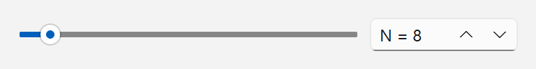

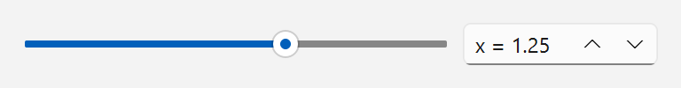

Un curseur et une boîte numérique liés, qui portent une seule valeur entière ou réelle.

| Élément | Détail |
| :--- | :--- |
| Importation | `from edustem.pyside6.widgets.q_slider_spin_box import QSliderSpinBox, QRealSliderSpinBox` |
| Valeur | `value()`, `setValue(v)`, `setRange(lo, hi)` |
| Texte | `setPrefix(str)`, `setSuffix(str)` |
| Signal | `valueChanged(v)` |
| Réel seulement | `setDecimals(n)` |

```python
step = QRealSliderSpinBox()
step.setRange(0.01, 1.0)
step.setPrefix("h = ")
step.valueChanged.connect(self.updateDerivative)
```

---

## `QRangeSlider` et `QRealRangeSlider`

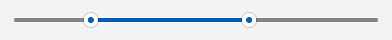

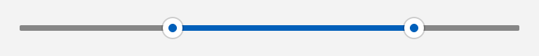

Curseur à deux poignées qui délimite un intervalle, entier ou réel.

| Élément | Détail |
| :--- | :--- |
| Importation | `from edustem.pyside6.widgets.q_range_slider import QRangeSlider, QRealRangeSlider` |
| Intervalle | `range()`, `setRange(lower, upper)`, `lowerValue()`, `upperValue()` |
| Limites | `setLimits(minimum, maximum)` |
| Signal | `rangeChanged(lower, upper)` |

```python
bounds = QRealRangeSlider()
bounds.setLimits(-5.0, 5.0)
bounds.setRange(-2.0, 3.0)
bounds.rangeChanged.connect(self.updateIntegral)
```

---

## `QRangeSpinBox` et `QRealRangeSpinBox`

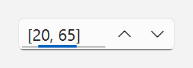

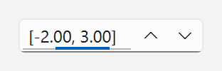

Boîte numérique qui saisit un intervalle `[a, b]`, entier ou réel.

| Élément | Détail |
| :--- | :--- |
| Importation | `from edustem.pyside6.widgets.q_range_spin_box import QRangeSpinBox, QRealRangeSpinBox` |
| Intervalle | `range()`, `setRange(lower, upper)`, `lowerValue()`, `upperValue()` |
| Limites | `setLimits(minimum, maximum)` |
| Signal | `rangeChanged(lower, upper)` |

```python
bounds = QRealRangeSpinBox()
bounds.setLimits(-5.0, 5.0)
bounds.setRange(-2.0, 3.0)
bounds.rangeChanged.connect(self.updateIntegral)
```

---

## `QRangeSliderSpinBox` et `QRealRangeSliderSpinBox`

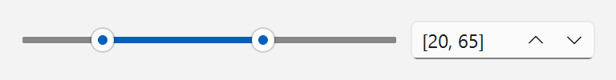

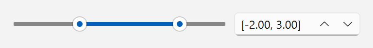

Un curseur à deux poignées et une boîte d'intervalle liés, qui portent un seul intervalle.

| Élément | Détail |
| :--- | :--- |
| Importation | `from edustem.pyside6.widgets.q_range_slider_spin_box import QRangeSliderSpinBox, QRealRangeSliderSpinBox` |
| Intervalle | `range()`, `setRange(lower, upper)`, `lowerValue()`, `upperValue()` |
| Limites | `setLimits(minimum, maximum)` |
| Signal | `rangeChanged(lower, upper)` |

```python
bounds = QRealRangeSliderSpinBox()
bounds.setLimits(-5.0, 5.0)
bounds.setRange(-2.0, 3.0)
bounds.rangeChanged.connect(self.updateIntegral)
```

---

## `QStateIndicatorBar`

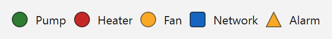

Rangée de voyants. Chacun montre l'état d'une source externe par sa couleur.

| Élément | Détail |
| :--- | :--- |
| Importation | `from edustem.pyside6.widgets.q_state_indicator_bar import QStateIndicatorBar, QStateSet` |
| Voyants | `addIndicator(nom, QStateSet)`, `addIndicators(noms, QStateSet)` |
| État | `setState(index, état)`, `setStates(liste)` |
| Signal | `indicatorClicked(index)` |

```python
bar = QStateIndicatorBar()
bar.addIndicators(["Pump", "Fan"], QStateSet.activity())
bar.setState(0, 2)
```

---

## `QDomainExplorerBox`

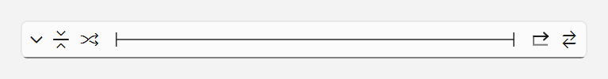

Axe à repères encadré de boutons, pour parcourir un domaine de valeurs : aller à un repère, réinitialiser, tirer au hasard ou animer.

| Élément | Détail |
| :--- | :--- |
| Importation | `from edustem.pyside6.widgets.q_domain_explorer_box import QDomainExplorerBox` |
| Repères | `setMarkerCount(n)` ; un repère n'apparaît qu'au survol. |
| Liaison | `setBinding(binding)` relie l'axe à un autre widget. |
| Signal | `positionRequested(float)`, une position de `0.0` à `1.0` |

```python
explorer = QDomainExplorerBox()
explorer.setMarkerCount(5)
explorer.positionRequested.connect(self.moveTo)
```

### Les liaisons

Une liaison (*binding*) relie l'explorateur à un autre widget. L'axe parcourt alors les valeurs de ce widget, et les boutons agissent sur lui.

```python
explorer.setBinding(QSpinBoxDomainBinding(spinBox))
```

| Liaison | Widgets liés |
| :--- | :--- |
| `QSliderDomainBinding` | `QSlider`, `QScrollBar`, `QDial` |
| `QSpinBoxDomainBinding` | `QSpinBox` |
| `QDoubleSpinBoxDomainBinding` | `QDoubleSpinBox` |
| `QComboBoxDomainBinding` | `QComboBox` |
| `QListViewDomainBinding` | `QListView`, `QListWidget` |
| `QCurrentIndexDomainBinding` | `QTabBar`, `QTabWidget`, `QToolBox` et tout widget doté de `currentIndex()` |
| `QButtonDomainBinding` | `QCheckBox`, `QRadioButton`, ou un `QPushButton` cochable |
| `QButtonGroupDomainBinding` | `QButtonGroup` |
| `QRealSliderDomainBinding` | `QRealSlider`, `QRealScrollBar`, `QRealDial` |
| `QSliderSpinBoxDomainBinding` | `QSliderSpinBox`, `QRealSliderSpinBox` |
| `QRangeDomainBinding` | `QRangeSlider`, `QRealRangeSlider`, `QRangeSpinBox`, `QRealRangeSpinBox`, `QRangeSliderSpinBox`, `QRealRangeSliderSpinBox` |
| `QCallbackDomainBinding` | Tout autre élément, par fonctions de rappel |

Les liaisons des widgets Qt se trouvent dans `q_domain_explorer_box`. Celles des widgets `edustem` se trouvent dans le module `q_*_domain_binding` du widget lié, par exemple `q_real_slider_domain_binding`.

---

## Classes utilitaires

`QAbstractObject` et `QAbstractWidget` permettent de déclarer une classe abstraite qui hérite de `QObject` ou de `QWidget`. Une classe ne peut pas hériter à la fois de `ABC` et de `QObject`. Ces deux classes contournent cette limite.

| Élément | Détail |
| :--- | :--- |
| Importation | `from edustem.pyside6.core.q_abstract_object import QAbstractObject` <br> `from edustem.pyside6.widgets.q_abstract_widget import QAbstractWidget` |

```python
class QAnalysisPanel(QAbstractWidget):
    @abstractmethod
    def reset(self) -> None: ...
```
