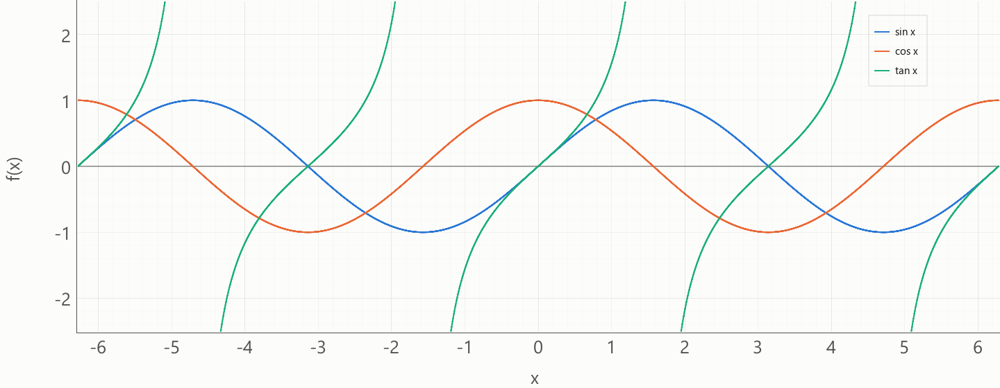
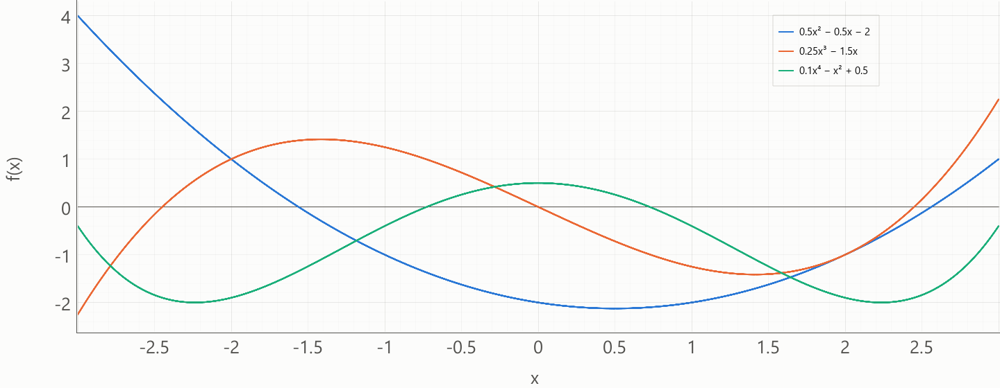
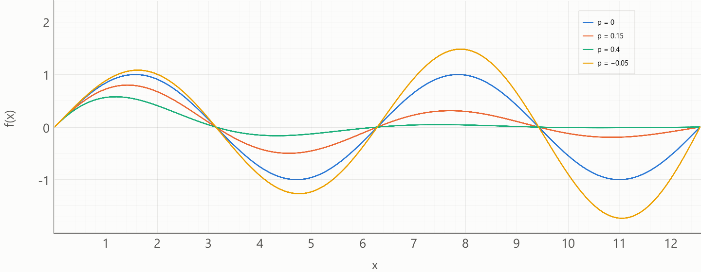
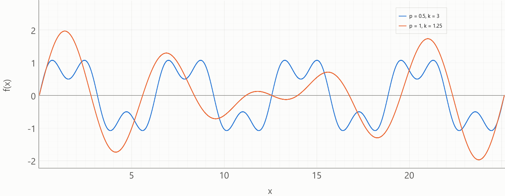
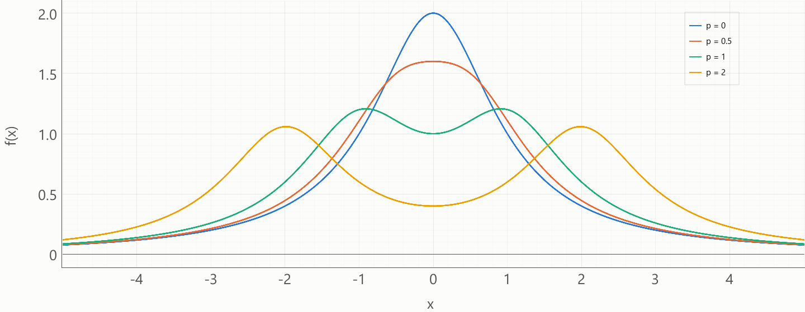
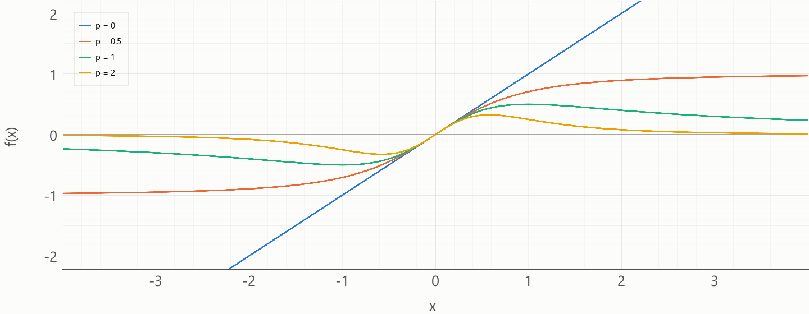
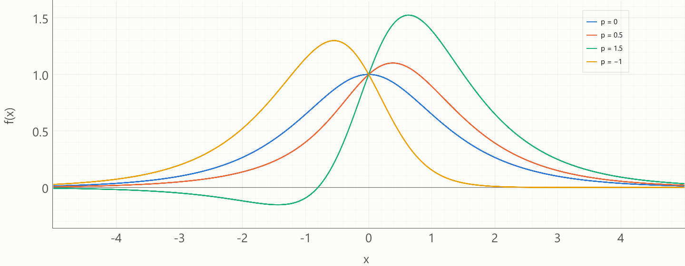

<small>**C**égep du **V**ieux **M**ontréal&nbsp;&nbsp;&nbsp;|&nbsp;&nbsp;&nbsp;**S**ciences, **I**nformatique et **M**athématique</small>  

# Catalogue de fonctions analytiques

Ce document présente une sélection de fonctions analytiques, choisies pour leur intérêt visuel et pour leurs **paramètres de forme**. Un paramètre de forme change réellement l'allure de la courbe. Il ne se réduit ni à une translation ni à une mise à l'échelle, qui relèvent de la [transformation canonique](math_transformation_canonique.md).

Pour chaque fonction, la dérivée et l'intégrale d'aire sont élémentaires. Elles donnent les **valeurs exactes**, auxquelles on compare les valeurs approchées des méthodes numériques. Les notations sont celles du [lexique](math_lexique.md).

$$m = f'(x) \qquad\qquad I(a, b) = \int_a^b f(x)\,dx$$

Lorsqu'une primitive est longue, elle est notée $F$ et l'intégrale vaut $\big[ F(x) \big]_a^b = F(b) - F(a)$.

Les formules d'intégrale valent quel que soit l'ordre des bornes : inverser $a$ et $b$ change seulement le signe de l'intégrale. L'ordre $a < b$ exigé par l'énoncé est une règle de saisie de l'interface, et non une condition des formules.

Chaque fonction indique un **intervalle de tracé suggéré**. C'est une valeur de départ pour l'affichage, et non une limite du domaine.

---

## 1. Les fonctions trigonométriques

Ces fonctions n'ont aucun paramètre de forme. Leur amplitude, leur période et leur phase s'obtiennent par la transformation canonique. Le cosinus est d'ailleurs un sinus décalé de $\delta_x = -\dfrac{\pi}{2}$ : la paire permet de vérifier la transformation.

| | Sinus | Cosinus | Tangente |
| :--- | :---: | :---: | :---: |
| Équation $f(x)$ | $\sin x$ | $\cos x$ | $\tan x$ |
| Domaine $\mathcal{D}$ | $\mathbb{R}$ | $\mathbb{R}$ | $x \neq \dfrac{\pi}{2} + k\pi$, $k \in \mathbb{Z}$ |
| Dérivée $f'(x)$ | $\cos x$ | $-\sin x$ | $\dfrac{1}{\cos^2 x}$ |
| Intégrale d'aire $I(a, b)$ | $\cos a - \cos b$ | $\sin b - \sin a$ | $\ln\lvert\cos a\rvert - \ln\lvert\cos b\rvert$ |
| Intervalle de tracé suggéré | $[-2\pi, 2\pi]$, deux périodes | $[-2\pi, 2\pi]$, deux périodes | $\left]-\dfrac{\pi}{2}, \dfrac{\pi}{2}\right[$, une branche |

Pour la tangente, les bornes d'intégration doivent appartenir à la même branche : aucune asymptote ne doit se trouver entre elles.

---

## 2. Le polynôme d'ordre $n$

### Domaines des intrants
* Ordre du polynôme : $n \in \mathbb{N}$
* Paramètres de forme : les $n + 1$ coefficients $c_i \in \mathbb{R}$, avec $c_n \neq 0$
* Variable indépendante : $x \in \mathbb{R}$
* Bornes d'intégration : $a, b \in \mathbb{R}$
* Intervalle de tracé suggéré : $x \in [-3, 3]$

Un polynôme croît très vite hors de la zone de ses racines. L'intervalle suggéré convient aux coefficients suggérés ci-dessous, dont les racines et les extremums s'y trouvent. Il est à ajuster selon les coefficients choisis.

Les premiers ordres, écrits en entier, rendent la forme générale plus concrète :

| | Ordre $1$, affine | Ordre $2$, quadratique | Ordre $3$, cubique | Ordre $n$ quelconque |
| :--- | :---: | :---: | :---: | :---: |
| Équation $f(x)$ | $c_0 + c_1 x$ | $c_0 + c_1 x + c_2 x^2$ | $c_0 + c_1 x + c_2 x^2 + c_3 x^3$ | $\displaystyle\sum_{i=0}^{n} c_i x^i$ |
| Dérivée $f'(x)$ | $c_1$ | $c_1 + 2 c_2 x$ | $c_1 + 2 c_2 x + 3 c_3 x^2$ | $\displaystyle\sum_{i=1}^{n} i\, c_i x^{i-1}$ |
| Intégrale d'aire $I(a, b)$ | $c_0 (b - a) + \dfrac{c_1}{2} (b^2 - a^2)$ | $c_0 (b - a) + \dfrac{c_1}{2} (b^2 - a^2) + \dfrac{c_2}{3} (b^3 - a^3)$ | $c_0 (b - a) + \dfrac{c_1}{2} (b^2 - a^2) + \dfrac{c_2}{3} (b^3 - a^3) + \dfrac{c_3}{4} (b^4 - a^4)$ | $\displaystyle\sum_{i=0}^{n} \frac{c_i}{i+1} \left(b^{i+1} - a^{i+1}\right)$ |
| Coefficients suggérés | $c_0 = 1$, $c_1 = 0.5$ | $c_0 = -2$, $c_1 = -0.5$, $c_2 = 0.5$ | $c_0 = 0$, $c_1 = -1.5$, $c_2 = 0$, $c_3 = 0.25$ | Ordre $4$ : $c_0 = 0.5$, $c_2 = -1$, $c_4 = 0.1$, les autres nuls |

---

## 3. La sinusoïde amortie

### Domaines des intrants
* Paramètre de forme, l'amortissement : $p \in \mathbb{R}$
* Variable indépendante : $x \in \mathbb{R}$
* Bornes d'intégration : $a, b \in \mathbb{R}$
* Intervalle de tracé suggéré : $x \in [0, 4\pi]$, soit deux oscillations

L'oscillation s'atténue vers la droite si $p > 0$ et s'amplifie si $p < 0$. Le cas $p = 0$ redonne le sinus. L'amplitude varie exponentiellement : l'intervalle suggéré convient à $|p| \le 0.5$ environ.

### Équation
$$f(x) = e^{-px}\sin x$$

### Dérivée
$$f'(x) = e^{-px}\left( \cos x - p\sin x \right)$$

### Intégrale d'aire
$$\begin{aligned}
I(a, b) &= \left[ -\frac{e^{-px}\left( p\sin x + \cos x \right)}{1 + p^2} \right]_a^b \\
&= \frac{e^{-pa}\left( p\sin a + \cos a \right) - e^{-pb}\left( p\sin b + \cos b \right)}{1 + p^2}
\end{aligned}$$

---

## 4. Le battement

### Domaines des intrants
* Paramètre de forme, l'amplitude relative : $p \in \mathbb{R}$
* Paramètre de forme, le rapport de fréquence : $k \in \mathbb{R}_+^*$
* Variable indépendante : $x \in \mathbb{R}$
* Bornes d'intégration : $a, b \in \mathbb{R}$
* Intervalle de tracé suggéré : $x \in [0, 8\pi]$

Deux sinusoïdes s'additionnent. Si $k$ est proche de $1$, l'amplitude enfle puis s'éteint lentement : ce sont des battements. Si $k$ est entier, la seconde sinusoïde est une harmonique de la première et déforme chaque période. Le cas $p = 0$ redonne le sinus.

### Équation
$$f(x) = \sin x + p \sin(kx)$$

### Dérivée
$$f'(x) = \cos x + p k \cos(kx)$$

### Intégrale d'aire
$$\begin{aligned}
I(a, b) &= \left[ -\cos x - \frac{p}{k} \cos(kx) \right]_a^b \\
&= \cos a - \cos b + \frac{p}{k} \big( \cos(ka) - \cos(kb) \big)
\end{aligned}$$

---

## 5. La double bosse

### Domaines des intrants
* Paramètre de forme, le demi-écart entre les bosses : $p \in \mathbb{R}$
* Variable indépendante : $x \in \mathbb{R}$
* Bornes d'intégration : $a, b \in \mathbb{R}$
* Intervalle de tracé suggéré : $x \in [-5, 5]$

Deux cloches, centrées en $-p$ et en $p$, s'additionnent. Pour $\lvert p \rvert < \dfrac{1}{\sqrt{3}} \approx 0.58$, elles se fondent en un seul pic. Au-delà, deux bosses se séparent. Le signe de $p$ ne change rien.

### Équation
$$f(x) = \frac{1}{1 + (x - p)^2} + \frac{1}{1 + (x + p)^2}$$

### Dérivée
$$f'(x) = -\frac{2 (x - p)}{\big(1 + (x - p)^2\big)^2} - \frac{2 (x + p)}{\big(1 + (x + p)^2\big)^2}$$

### Intégrale d'aire
$$\begin{aligned}
I(a, b) &= \Big[ \arctan(x - p) + \arctan(x + p) \Big]_a^b \\
&= \arctan(b - p) - \arctan(a - p) + \arctan(b + p) - \arctan(a + p)
\end{aligned}$$

---

## 6. La saturation

### Domaines des intrants
* Paramètre de forme, la force de la saturation : $p \in \mathbb{R}$
* Variable indépendante : $x \in \mathbb{R}$
* Bornes d'intégration : $a, b \in \mathbb{R}$
* Intervalle de tracé suggéré : $x \in [-4, 4]$

Un seul paramètre fait passer la fonction par des formes très différentes :
* $p = 0$ : la droite $y = x$.
* $p = \frac{1}{2}$ : une sigmoïde qui sature vers $\pm 1$.
* $p = 1$ : une onde qui revient vers $0$ de part et d'autre.
* $p > 1$ : une impulsion de plus en plus brève.
* $p < 0$ : une croissance plus rapide que linéaire.

### Équation
$$f(x) = \frac{x}{(1 + x^2)^p}$$

### Dérivée
$$f'(x) = \frac{1 + (1 - 2p)\, x^2}{(1 + x^2)^{p + 1}}$$

### Intégrale d'aire
Pour $p \neq 1$ :
$$\begin{aligned}
I(a, b) &= \left[ \frac{(1 + x^2)^{1 - p}}{2 (1 - p)} \right]_a^b \\
&= \frac{(1 + b^2)^{1 - p} - (1 + a^2)^{1 - p}}{2 (1 - p)}
\end{aligned}$$

Pour $p = 1$, la primitive devient un logarithme :
$$I(a, b) = \frac{1}{2} \ln\left( \frac{1 + b^2}{1 + a^2} \right)$$

---

## 7. La cloche hyperbolique asymétrique

### Domaines des intrants
* Paramètre de forme, l'asymétrie : $p \in \mathbb{R}$
* Variable indépendante : $x \in \mathbb{R}$
* Bornes d'intégration : $a, b \in \mathbb{R}$
* Intervalle de tracé suggéré : $x \in [-5, 5]$

Les fonctions hyperboliques sont de simples combinaisons d'exponentielles : $\cosh x = \dfrac{e^x + e^{-x}}{2}$, $\sinh x = \dfrac{e^x - e^{-x}}{2}$ et $\tanh x = \dfrac{\sinh x}{\cosh x}$.

> Il n'est pas nécessaire de les maîtriser pour utiliser cette fonction. On l'exploite comme un outil mathématique existant : ses formules sont données ci-dessous. Le module `math` fournit `math.cosh`, `math.sinh` et `math.tanh`, et `NumPy` fournit `np.cosh`, `np.sinh` et `np.tanh`.

La sécante hyperbolique, $\operatorname{sech} x = \dfrac{1}{\cosh x}$, est une cloche symétrique. Le facteur $1 + p \tanh x$ la penche : vers la droite si $p > 0$, vers la gauche si $p < 0$. Pour $\lvert p \rvert > 1$, un creux sous l'axe apparaît du côté opposé.

### Équation
$$f(x) = \operatorname{sech} x \, (1 + p \tanh x)$$

### Dérivée
$$f'(x) = \operatorname{sech} x \, \big( p (1 - 2 \tanh^2 x) - \tanh x \big)$$

### Intégrale d'aire
$$\begin{aligned}
I(a, b) &= \Big[ \arctan(\sinh x) - p \operatorname{sech} x \Big]_a^b \\
&= \arctan(\sinh b) - \arctan(\sinh a) - p \big( \operatorname{sech} b - \operatorname{sech} a \big)
\end{aligned}$$
