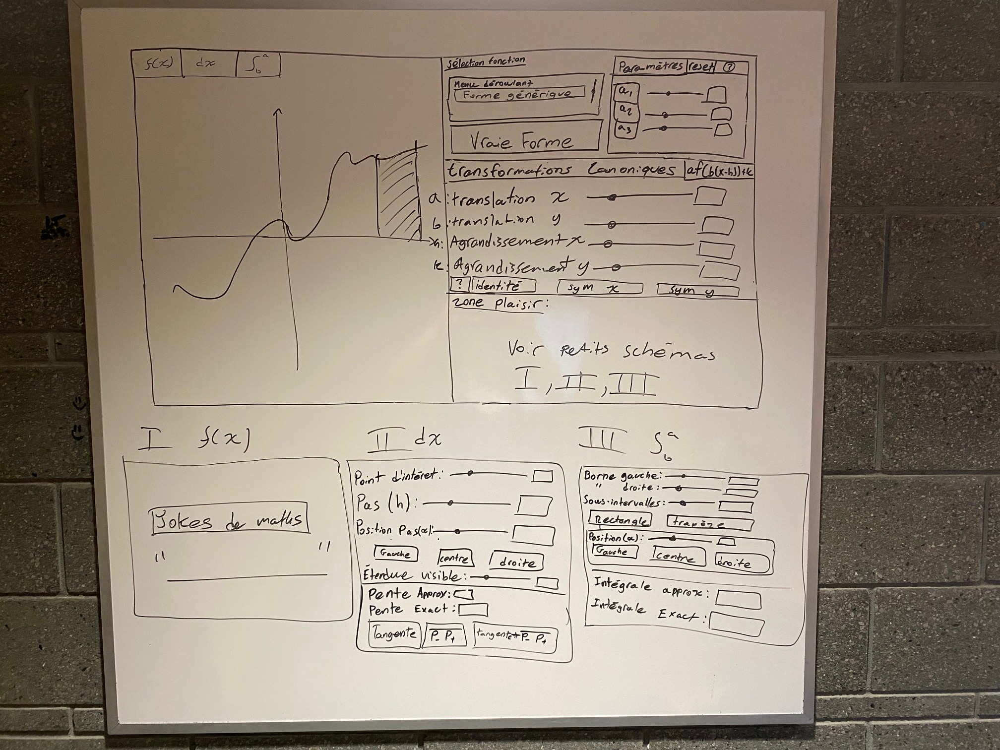

<small>**C**égep du **V**ieux **M**ontréal&nbsp;&nbsp;&nbsp;|&nbsp;&nbsp;&nbsp;**S**ciences, **I**nformatique et **M**athématique</small><br><br>

# Maquettes de l'interface graphique

Ce document assemble toutes les maquettes de l'interface graphique de votre logiciel. Consultez le guide [Le maquettage d'une interface graphique](../../in/guides/maquettage_interface_graphique.md) avant de commencer.

Les maquettes sont des fichiers image déposés dans le dossier `doc/out/assets/`. Le format PNG est recommandé. Chaque image est insérée ici, accompagnée de quelques mots d'explication. Une image s'insère ainsi :

```markdown

```

Remplacez le contenu des sections par le vôtre, puis retirez les consignes en italique.

## Version initiale



### Vue d'ensemble

À gauche, nous avons le graphique. À droite, en partant du haut, nous avons la sélection de la fonction, les transformations canoniques et les méthode numériques (I, II et III)

### Panneaux

Ceux-ci sont intégrés dans la version initiale sous "Zone plaisir".

## Version finale

La maquette initiale est assez fidèle, mais en pratique nous avons ajoutés quelques boutons et labels. C'est pour cela que nous n'avons pas fait de maquette finale
