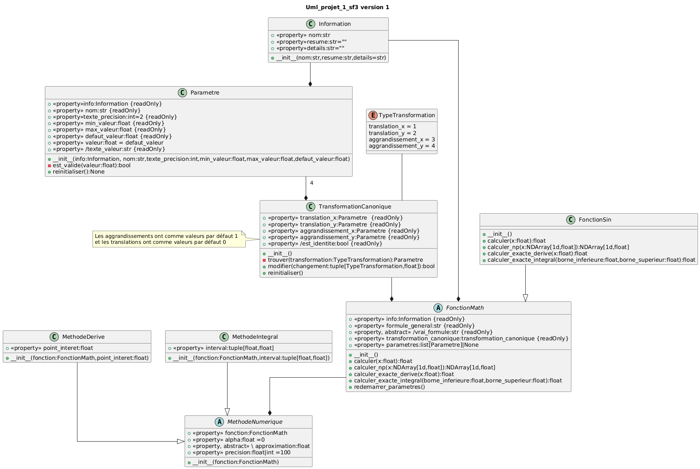
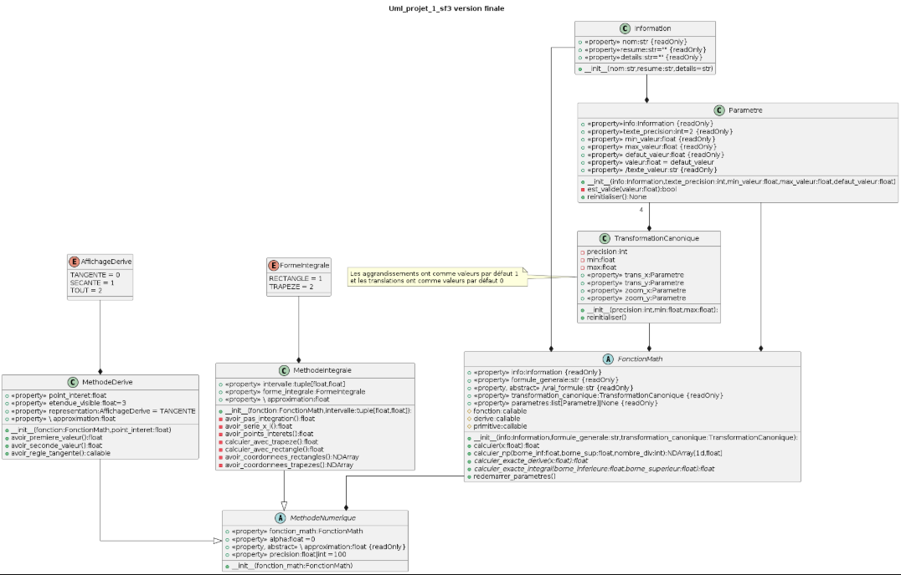
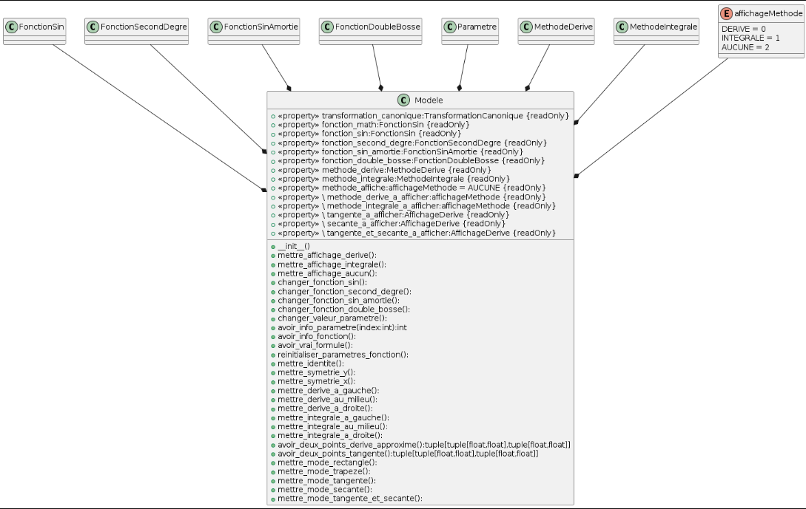

<small>**C**égep du **V**ieux **M**ontréal&nbsp;&nbsp;&nbsp;|&nbsp;&nbsp;&nbsp;**S**ciences, **I**nformatique et **M**athématique</small><br><br>

# Diagrammes de classes UML du modèle

Ce document assemble tous les diagrammes de classes UML du modèle de votre logiciel. Consultez le guide [Le diagramme de classes UML](../../in/guides/diagramme_classes_uml.md) avant de commencer.

Seules les classes du modèle sont attendues : les fonctions mathématiques et les méthodes d'analyse numérique. Les classes de l'interface graphique n'en font pas partie.

Les diagrammes sont des fichiers image déposés dans le dossier `doc/out/assets/`. Le format PNG est recommandé. Chaque image est insérée ici, accompagnée de quelques mots d'explication. Le fichier source d'un diagramme, s'il existe, va dans `doc/out/work/`. Une image s'insère ainsi :

```markdown

```

Remplacez le contenu des sections par le vôtre, puis retirez les consignes en italique.

## Version initiale



### Fonctions mathématiques

Nous avons les classes FonctionSin, FonctionSinAmortie, FonctionDoubleBosse, FonctionSecondDegree, qui sont tous enfants de FonctionMath. Cette dernière contient jusqu'à n instance de la classe Parametre, et 1 instance de TransformationCanonique, qui contient 4 instance de Parametre


### Méthodes d'analyse numérique

Nous avons les classes MethodeDerive et MethodeIntegrale, qui sont des enfants de MethodeNumerique

## Version finale



